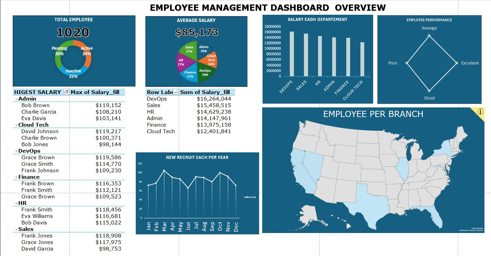

# Employee Management Dashboard: Data Cleaning & EDA in Excel

An end-to-end Excel project: take a deliberately **messy HR dataset** (1,020 employees), clean it, explore it, and present the results in an interactive **Employee Management Dashboard**.



---

## Table of Contents
1. [Business Questions](#1-business-questions)
2. [Dataset & Workbook Structure](#2-dataset--workbook-structure)
3. [Data Quality Audit & Cleaning](#3-data-quality-audit--cleaning)
4. [Exploratory Data Analysis](#4-exploratory-data-analysis)
5. [Dashboard Review](#5-dashboard-review)
6. [Key Insights & Recommendations](#6-key-insights--recommendations)
7. [Limitations](#7-limitations)
8. [Repository Structure](#8-repository-structure)

---

## 1. Business Questions

- How large is the workforce, and how many employees are actually **Active**?
- Where does payroll go: which **departments** and **branches** cost the most?
- Is pay linked to **department, location, age, tenure or performance**?
- When does the company **hire**, and has hiring grown?
- Is the raw data **trustworthy enough** to report from?

## 2. Dataset & Workbook Structure

**File:** `Messy_Employee_dataset.xlsx`: 1,020 rows, one per employee (`Employee_ID` is unique).

| Sheet | Purpose |
|---|---|
| `Messy_Employee_dataset` | Raw data (12 columns) |
| `Table_Employee` | Cleaned table (19 columns) with derived fields |
| `MessyWorkChart` | PivotTables and working charts that feed the dashboard |
| `Dashboard` | Final one-page dashboard |

**Raw columns:** Employee_ID, First_Name, Last_Name, Age, Department_Region, Status, Join_Date, Salary, Email, Phone, Performance_Score, Remote_Work.

**Features added during cleaning:** `Department`, `Region`, `Salary_fill`, `Format_Phone`, `Phone_AF`, `Name_Concat`, `Tenure`, `NameConReg`.

**Tools:** Excel (formulas, PivotTables, PivotCharts, map chart, radar chart). EDA statistics were verified with Python (pandas, SciPy).

## 3. Data Quality Audit & Cleaning

| # | Issue found | Scale | Treatment | Impact / risk |
|---|---|---|---|---|
| 1 | **Missing `Salary`** | 24 rows (2.4%) | Imputed into `Salary_fill` | Safe. Mean moved from $85,155 to $85,173 (+$18) |
| 2 | **Missing `Age`** | 211 rows (20.7%) | Filled with **30** (the median) | **Distorts the distribution**: the age-30 bucket doubles from 205 to 416 (see note below) |
| 3 | **Two attributes in one column**: `Department_Region` (e.g. `Cloud Tech-Florida`) | 1,020 rows, 36 combinations | Split into `Department` (6) and `Region` (6) | Enables per-department and per-branch analysis |
| 4 | **Phone stored as negative integers** | 100% of rows; 92 have fewer than 10 digits | Absolute value, zero-padded, formatted `(xxx) xxx-xxxx` | Cosmetic. These numbers are not valid phone numbers |
| 5 | **Email is not unique** | 64 unique emails across 1,020 rows (956 repeats) | Kept; `Employee_ID` used as the key | Never join or de-duplicate on email or name |
| 6 | **Names repeat heavily** | 8 first × 8 last names = 64 unique full names | `Name_Concat` created for display only | Name-based pivots silently merge different people (see [Dashboard Review](#5-dashboard-review)) |
| 7 | **Tenure is snapshot-dependent** | Matches full years from the join date to *today* for 99.6% of rows | Derived `Tenure` | Values change whenever the file is reopened and recalculated |

No duplicate rows or duplicate `Employee_ID`s were found. All join dates fall between **2020-01-01 and 2024-12-29**.

> **Analyst note:** filling 211 missing ages with one constant manufactures a spike at 30. Any age-based finding below should be read with that in mind. A better approach is to leave age blank (and exclude it from age analysis) or impute within department.

## 4. Exploratory Data Analysis

### 4.1 Workforce snapshot

| Metric | Value |
|---|---|
| Total employees | **1,020** |
| Average salary | **$85,173** (median $85,622) |
| Salary range | $50,047 to $119,972 |
| Total annual payroll | **$86.88M** |
| Remote workers | 513 (50.3%) vs on-site 507 (49.7%) |
| Average tenure | 3.7 years |

### 4.2 Salary distribution

- The distribution is **flat, almost uniform** between $50K and $120K (skew ≈ 0, standard deviation ≈ $19.7K).
- **No statistical outliers** by the IQR rule.
- 25.8% of staff earn $100K or more; 13.6% earn under $60K.

### 4.3 Department analysis

| Department | Headcount | Total payroll | Avg salary | Active % | Inactive % |
|---|---:|---:|---:|---:|---:|
| DevOps | 189 | $16.26M | $86,053 | **41.3%** | 30.7% |
| Sales | 178 | $15.46M | **$86,846** | 36.5% | 28.1% |
| HR | 171 | $14.63M | $85,551 | 33.3% | 28.7% |
| Admin | 166 | $14.15M | $85,229 | 34.9% | 30.7% |
| Finance | 170 | $13.98M | $82,207 | 28.8% | **36.5%** |
| Cloud Tech | 146 | $12.40M | $84,944 | 30.8% | 28.8% |

- **DevOps and Sales** are the largest cost centres (together 36% of payroll). The ranking is driven by *headcount*, not pay rates.
- **Average pay barely differs** across departments (range $82.2K to $86.8K). The confidence intervals overlap, and a one-way ANOVA confirms the gap is **not significant** (p = 0.35).
- **Finance** has the lowest average pay *and* the highest inactive share (36.5%), so it is worth a closer look.
- **DevOps** has the healthiest active share (41.3%). **Cloud Tech** has the most Pending employees (40.4%).

### 4.4 Employee status

| Status | Count | Share |
|---|---:|---:|
| Pending | 356 | 34.9% |
| Active | 352 | 34.5% |
| Inactive | 312 | 30.6% |

- **Only about one in three employees is Active.** Pending and Inactive together make up 65%.
- Status differences between departments look large on the chart but are **not statistically significant** (χ² p = 0.29).
- Status is also unrelated to performance (p = 0.58) and to salary (Active $85.1K, Inactive $84.7K, Pending $85.7K).

### 4.5 Performance

| Score | Count | Share | Avg salary |
|---|---:|---:|---:|
| Good | 270 | 26.5% | $86,311 |
| Average | 267 | 26.2% | $84,281 |
| Excellent | 267 | 26.2% | $85,023 |
| Poor | 216 | 21.2% | $85,040 |

- Roughly **79% of employees are rated Average or better**; 21% are Poor.
- **Pay does not follow performance.** "Poor" performers earn about the same as "Excellent" ones ($85,040 vs $85,023). This is the most actionable finding for HR.
- Sales has the lowest share of Poor ratings (17.4%) and Finance the highest (24.7%).

### 4.6 Branch (region) analysis

| Region | Employees | Avg salary |
|---|---:|---:|
| California | 187 | $86,677 |
| Florida | 185 | $86,442 |
| Nevada | 169 | $83,528 |
| Illinois | 165 | $85,321 |
| New York | 161 | $83,680 |
| Texas | 153 | $85,030 |

- California and Florida are the two largest branches (36% of staff) and also the best paid.
- Regional pay differences (about $3K) are **not significant** (Kruskal-Wallis p = 0.52).
- Texas is the smallest branch (153); Cloud Tech in Illinois is the smallest single team (16).

### 4.7 Hiring trends

| Year | 2020 | 2021 | 2022 | 2023 | 2024 |
|---|---:|---:|---:|---:|---:|
| Hires | 203 | 189 | 183 | **228** | 217 |

- Hiring dipped to a low in 2022 and **rebounded about 25% in 2023** (183 to 228), then held steady in 2024.
- **Seasonality:** March (105) and October (100) are the peak hiring months. June is the trough (66), followed by January and December (72 each).
- Hiring runs in two waves, spring and autumn, which suggests a planned hiring-cycle pattern.

### 4.8 Age, tenure and remote work

- **Age vs salary:** weak positive correlation (r = 0.08). The 40-year-old group averages $88.4K against $83.1K for 25-year-olds, but the age imputation limits how far this can be trusted.
- **Tenure vs salary:** essentially zero correlation (r = 0.01). Longer-serving employees are not paid more.
- **Remote work:** split 50/50 in every department (47% to 53%). Remote staff earn slightly less ($84.5K vs $85.9K), which is not meaningful.

## 5. Dashboard Review

The dashboard combines KPI cards (total employees with status donut, average salary with department pie), a salary-by-department column chart, a performance radar, a top-earners PivotTable, a department payroll table, a monthly hiring line chart and a US map of employee locations. Every headline number was re-computed and **matches the data** (1,020 employees, $85,173 average, status split 34/35/31%, department payroll totals).

Issues found during review:

| Finding | Detail | Suggested fix |
|---|---|---|
| **"Highest Salary" table is not a true top-3** | The PivotTable is built on *names* (only 64 unique) and its Top-3 filter ranks names by their **summed** salary, then displays the max. In Admin it lists Bob Brown ($119,152) first, but the real top earner is Alice Brown ($119,574). In Cloud Tech, the real top earner, Charlie Smith ($119,972), is missing | Build the pivot on `Employee_ID` and filter Top 3 by *Max of Salary_fill* |
| **Hiring chart title is misleading** | "New recruit each per year" plots **months** (Jan to Dec) pooled across five years | Retitle it "New hires by month (2020–2024)", or plot by year |
| **Radar chart is hard to read** | Four categories with near-identical values form a diamond with no data labels | Use a bar chart with counts and percentages |
| **Map has no values** | States are shaded but headcount is not shown | Add data labels or a graded colour scale |
| **Typos** | "HIGESTSALARY", "SALARY EADH DEPARTEMENT" | Fix the titles |
| **Bar chart readability** | The salary-by-department chart uses raw numbers (16000000) | Format axis as $M |

## 6. Key Insights & Recommendations

1. **Pay is flat across every dimension.** Department, region, tenure and performance all show near-zero effect on salary. Either pay bands are being ignored or the pay structure is not rewarding anything. *Review compensation policy.*
2. **Performance is not rewarded.** Poor and Excellent performers earn the same. *Introduce performance-linked pay.*
3. **Only 34.5% of employees are Active.** Clarify what "Pending" means (onboarding, leave, notice period?) and investigate the 31% Inactive group, starting with **Finance** (36.5% inactive, lowest pay, most Poor ratings).
4. **DevOps and Sales drive payroll** through headcount. Use them first for workforce-planning scenarios.
5. **Plan around hiring seasonality.** Recruiting capacity is needed in March and October.
6. **Fix data capture at source:** enforce unique emails, valid phone formats and mandatory Age and Salary fields.

## 7. Limitations

- The dataset appears **synthetic**: uniform salaries, a fixed pool of 8 first and 8 last names, ages in only four values (25/30/35/40), `example.com` emails and near-equal category splits. That is why almost no statistical test finds a significant difference. The methodology transfers to real HR data, but the business findings should not be read as real-world conclusions.
- Age is imputed for 20.7% of employees, which weakens age-based analysis.
- `Tenure` is recalculated against the current date, so it is not reproducible over time.
- There is no termination date, so `Inactive` cannot be turned into an attrition rate.
- Only one snapshot exists, so there is no trend in salary or status over time.

## 8. Repository Structure

```
├── Messy_Employee_dataset.xlsx     # Raw data, cleaned table, pivots and dashboard
├── README.md
```

**To explore:** open the workbook and go through `Messy_Employee_dataset` (raw), `Table_Employee` (cleaned), `MessyWorkChart` (pivots) and `Dashboard` (final view).
